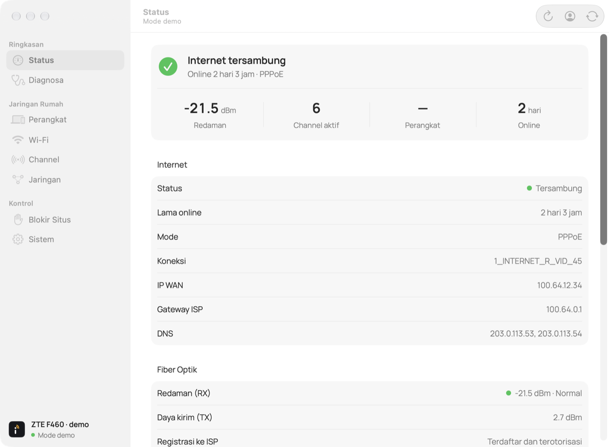

# iwifyou

App macOS untuk router **ZTE F460** tanpa membuka panel 192.168.1.1 di browser: status internet dan redaman fiber, daftar dan blokir perangkat, info serta nama/password Wi-Fi, kualitas dan pergantian channel 2,4 GHz, diagnosa koneksi, IP tetap, port forwarding, blokir situs, notifikasi perangkat baru, dan restart router. Tampil sebagai jendela biasa di Dock, dengan ikon menu bar untuk ganti channel cepat.

[English](README.md)



> [!WARNING]
> iwifyou adalah proyek independen, **tidak berafiliasi dengan atau didukung oleh ZTE** maupun penyedia internet mana pun. App baru diuji pada **satu** unit F460 bawaan ISP; varian firmware lain bisa berbeda, dan app menolak halaman yang tidak dikenalinya. Mengubah pengaturan router bisa memutus koneksi; risiko pemakaian ditanggung sendiri (lihat [LICENSE](LICENSE)).

## Tampilan dan logo

Logo: huruf "i" yang titiknya memancarkan dua gelombang sinyal — ubin tinta, huruf putih, gelombang amber, tanpa gradasi. Ikon app digambar sebagai vektor oleh `scripts/make-icon.swift` (`swift scripts/make-icon.swift preview.png` untuk pratinjau 1024 px); geometri yang sama ada di `Sources/iwifyou/Logo.swift` untuk sidebar dan ikon template menu bar.

Tampilan mengikuti pola app Mac bawaan: sidebar sistem, judul halaman di toolbar, form bergrup (`.formStyle(.grouped)`), kontrol native, dan warna aksen dari pengaturan macOS. Font **Manrope** (SIL OFL 1.1, `Resources/Fonts`, didaftarkan lewat `ATSApplicationFontsPath`). Komponen bersama ada di `Sources/iwifyou/DesignSystem.swift`.

Di **Blokir Situs**, semua situs bisa dihapus, termasuk preset YouTube/TikTok. **Hapus** membuka blokir di router lalu menghapus situs dari daftar; preset yang dihapus bisa ditambahkan lagi lewat **Tambah Cepat**.

## Fitur

| Bagian | Isi | Sumber di router |
|---|---|---|
| **Status** | Internet (PPPoE, IP WAN, DNS, lama online), redaman fiber RX/TX dengan warna normal/batas/buruk, registrasi ke ISP, suhu modul, channel aktif, model dan versi router | `status_ethwan_if_t.gch`, `pon_status_link_info_t.gch`, `e8_status_wlan_info_t.gch`, `status_dev_info_t.gch` |
| **Perangkat** | Klien DHCP (IP, MAC, port Wi-Fi/LAN, hostname), status aktif dari tabel ARP, blokir/buka blokir, nama lokal | `status_lan_info_t.gch`, `diag_netDiag_arpTable_t.gch`, `sec_macfilter_conf_t.gch` |
| **Wi-Fi** | SSID, keamanan, enkripsi, standar, lebar channel, channel aktif, daya pancar, wilayah, batas klien; **ubah nama & password** | `pon_net_wlan_conf_t.gch` (password hanya dibandingkan di memori, tidak ditampilkan) |
| **Channel** | Grafik kualitas tiap channel dari rata-rata beberapa pindaian Wi-Fi Mac (3 per klik, riwayat 15 menit), saran hanya jika sebuah channel konsisten jauh lebih lega daripada channel yang dipakai, channel aktif saat Auto, ganti channel | CoreWLAN di Mac + `pon_net_wlan_conf_t.gch` |
| **Diagnosa** | Satu kesimpulan (Wi-Fi / router / fiber-ISP / DNS) dari sinyal Mac, ping router, ping 1.1.1.1, DNS, status WAN, redaman; **meter sinyal live** dengan grafik | `ping` dan CoreWLAN di Mac + halaman status |
| **Jaringan** | IP tetap (reservasi DHCP) dan port forwarding, dengan peringatan jika IP WAN bukan IP publik (CGNAT) | `net_dhcp_static_t.gch`, `app_virtual_conf_t.gch` |
| **Blokir situs** | **Blokir lewat DNS router** (preset YouTube dan TikTok, domain sendiri, tombol Uji DNS) yang juga berlaku untuk HTTPS; plus filter URL router yang hanya efektif untuk HTTP | `app_dev_name_t.gch` (Hosts), `sec_url_filter_t.gch` |
| **Sistem** | Restart router dengan pemantauan mati → menyala, notifikasi koneksi lemot + saran channel, notifikasi perangkat baru, sesi admin, akun | `manager_dev_restart_t.gch` |

**Batasi kecepatan per perangkat tidak tersedia.** Firmware F460 ini hanya punya *Entrance speed limit* per port/SSID (QoS), yang memperlambat semua perangkat sekaligus.

## Menjalankan

### Unduh

1. Unduh `iwifyou-<versi>-macos.zip` dari [release terbaru](https://github.com/ajipurn/iwifyou/releases/latest). Berjalan di Mac Apple Silicon dan Intel dengan macOS 14 atau lebih baru.
2. Ekstrak lalu pindahkan `iwifyou.app` ke **Applications**.
3. App belum dinotarisasi Apple, jadi pembukaan pertama diblokir:
   - **macOS 15 atau lebih baru:** buka app sekali, lalu ke **Pengaturan Sistem › Privasi & Keamanan** dan klik **Tetap Buka**.
   - **macOS 14:** Control-klik app, pilih **Buka**, lalu konfirmasi.

Atau lewat Terminal, hapus tanda unduhan sekali saja: `xattr -dr com.apple.quarantine /Applications/iwifyou.app`.

### Build dari source

Memerlukan macOS 14 atau lebih baru dan toolchain Swift 6.2 atau lebih baru (Xcode 26 atau Command Line Tools). Tidak ada dependensi paket eksternal.

```sh
git clone https://github.com/ajipurn/iwifyou.git
cd iwifyou
./scripts/build-app.sh
open build/iwifyou.app
```

Build lokal langsung terbuka. Tambahkan `--universal` untuk build Apple Silicon sekaligus Intel, seperti file release.

Jendela utama terbuka dan app tampil di Dock; logo iwifyou juga muncul di menu bar. Jendela **Akun router** terbuka pada pembukaan pertama. Menutup jendela tidak menghentikan app: klik ikon Dock atau **Buka jendela** di menu bar untuk membukanya lagi.

1. Di jendela **Akun router**, masukkan IP router, misalnya `192.168.1.1`.
2. Ganti channel dari bagian **Channel** di jendela utama atau dari ikon menu bar.
3. Gunakan akun admin panel router. Jika sesi router masih aktif, kolom akun boleh kosong.
4. Pilih **Simpan password di Keychain** hanya jika ingin menyimpan login pada Mac ini.
5. Pilih **Auto** atau nomor channel, lalu klik **Terapkan**.

Wi-Fi bisa terputus sebentar. iwifyou membaca ulang konfigurasi setelah perubahan; status berhasil hanya ditampilkan setelah hasil terverifikasi. Jika belum terverifikasi, sambungkan kembali Wi-Fi lalu klik **Perbarui**.

## Sesi admin

- Sesi yang sudah aktif dipakai ulang untuk beberapa perubahan channel.
- Setelah **2 menit idle**, app mengirim logout. Membuka panel app, memilih channel, menghubungkan, atau memperbarui status mengulang hitungan idle. Timer dihentikan selama operasi router berlangsung.
- Sesudah logout, konfigurasi terakhir tetap terlihat sebagai data terakhir dibaca. App tidak login lagi hanya karena panel menu bar dibuka.
- Jika password disimpan di Keychain, penggunaan berikutnya bisa login otomatis satu kali. Jika tidak disimpan, app meminta login lagi melalui Pengaturan.
- **Buka admin router** melepas sesi app dan memverifikasi bahwa halaman WLAN sudah tidak dapat diakses sebelum membuka browser. Browser tidak dibuka jika logout belum terverifikasi.
- Keluar dari app secara normal juga mencoba logout. Force Quit, Mac mati, jaringan terputus, atau sesi lama dari proses yang sudah hilang tidak menjamin sesi server ikut dilepas.

Logout memakai form `flogout` yang dikenali, `logout=1`, token terakhir dari sesi URLSession yang sama, dan cookie milik app. App tidak login atau menebak token untuk memaksa sesi admin lain keluar. Respons HTTP 200 atau tampilan login saja tidak dianggap bukti: app mengecek halaman WLAN yang terlindungi. POST logout yang responsnya terputus tidak dikirim ulang otomatis.

Jika router masih menampilkan **Another user has logged in** dari sesi lama, logout dari tab/perangkat yang masih memilikinya. Sesi yang cookie-nya telah hilang tidak bisa diambil kembali oleh app; reboot biasa router dapat menjadi pemulihan, dengan internet terputus sementara.

Untuk mencoba antarmuka tanpa jaringan atau Keychain:

```sh
build/iwifyou.app/Contents/MacOS/iwifyou --demo
```

Tutup instance iwifyou lain sebelum menjalankan mode demo. Mode demo selalu diberi label dan tidak mengirim permintaan router.

## Cakupan versi awal

- Pilihan channel berdasarkan daftar dan batas negara pada form router.
- Deteksi pengaturan yang berubah sejak terakhir dibaca.
- Login dengan token segar, maksimal satu percobaan per operasi.
- Cookie sesi hanya di memori; password tersimpan hanya jika pengguna memilih Keychain.
- Hanya IP privat IPv4 dan loopback yang diterima. Redirect ke origin lain ditolak; validasi sertifikat HTTPS tetap aktif.
- Pindaian channel memakai radio Wi-Fi Mac di posisinya sekarang; saran channel tidak pernah diterapkan otomatis. Nama jaringan sekitar hanya tampil jika iwifyou diberi akses Lokasi (aturan macOS); tanpa itu, Wi-Fi sendiri ikut terhitung sebagai gangguan.
- Belum mencakup router lain, radio 5 GHz, login saat startup, distribusi App Store, atau notarization. Bundle lokal menggunakan tanda tangan ad hoc.

## Integrasi F460

Adapter diturunkan dari form yang dibaca langsung dari perangkat F460 pada sesi pengembangan:

```text
GET  /getpage.gch?pid=1002&nextpage=pon_net_wlan_conf_t.gch
POST /                         (login jika diperlukan)
POST /getpage.gch?pid=1002&nextpage=pon_net_wlan_conf_t.gch
```

Parser membaca initializer scalar `Transfer_meaning(...)`, tanpa menjalankan JavaScript router. Adapter menolak struktur konfigurasi yang belum dikenali.

Firmware menambahkan hidden input `_SESSION_TOKEN` melalui fungsi JavaScript `addToken2AllForms()` saat halaman dimuat. Adapter mengenali hook tersebut dan mengambil token dari halaman terbaru sebelum Submit, tanpa menjalankan JavaScript. Token wajib ada, tidak dicatat ke log, dan tidak masuk fingerprint konfigurasi. Request yang ditolak tidak dikirim ulang otomatis.

Firmware ini memakai literal `NULL` dalam `HiddenParaInit()` untuk melewati parameter konfigurasi. Payload perubahan hanya mengisi `Channel` dan `AutoChannelEnabled`, memakai `IF_CONFIGTAG=Y`, dan menonaktifkan flag pembaruan PSK/WEP. SSID, password, keamanan, daya pancar, dan bandwidth tidak ditulis ulang.

Sebelum Submit, app membaca konfigurasi terbaru dan membandingkan fingerprint dengan pembacaan sebelumnya. Setelah Submit, app memverifikasi channel dan fingerprint pengaturan lain. POST yang terputus tidak dikirim ulang otomatis. Pesan tidak terverifikasi tidak dianggap sukses.

**Batas verifikasi:** pembacaan konfigurasi firmware perangkat asli diuji; penulisan channel diuji dengan simulator lokal. Mengubah channel pada perangkat asli masih perlu uji langsung oleh pengguna. Respons simulator tidak membuktikan perilaku backend seluruh varian firmware F460.

### Perangkat, blokir, dan restart

Halaman dipetakan dari menu firmware F460 asli secara read-only (GET saja) dan dicocokkan dengan pemanggilan `pageLoad(getURL("<halaman>"))`, deklarasi `new Array(...)`, dan field tersembunyi form `fSubmit`. Struktur yang berbeda ditolak sebagai firmware belum dikenali.

- **Daftar perangkat** dibaca dari `IF_INSTNUM` dan baris `MACAddrN`, `IPAddrN`, `HostNameN`, `ExpiredTimeN`, `PhyPortNameN`, `PhyTypeN`. Perangkat yang alamat IP-nya milik Mac ini ditandai **Mac ini** dan tidak bisa diblokir.
- **Blokir** memakai Security › MAC Filter dengan mode Blacklist (`MacFilterTarget=Discard`), meniru JavaScript halaman: `basic_apply` untuk menyalakan filter (hanya jika filter mati), lalu `new` dengan `SrcMacAddr`, `Type=Bridge+Route`, `Protocol=ALL`. Parameter lain diisi `NULL` seperti `HiddenParaInit()`. **Buka blokir** mengirim `delete` dengan `IF_INDEX`. Setiap perubahan diverifikasi dengan membaca ulang filter; POST tidak dikirim ulang. Jika router memakai mode Whitelist, atau filter mati tetapi sudah berisi aturan, iwifyou menolak mengubahnya.
- Perangkat yang diblokir masih bisa tersambung ke Wi-Fi, tetapi trafiknya dibuang router. Perangkat dengan MAC acak bisa lolos jika MAC-nya berganti.
- **Restart** mengirim `IF_ACTION=devrestart` dan `flag=1` sekali, lalu memantau router sampai tidak terjangkau dan terjangkau lagi (maks. ±4 menit). Sesi admin dianggap berakhir.

### Status, Wi-Fi, jaringan, dan blokir situs

- **Status** dibaca dari baris tabel `tdleft`/`tdright` yang dirender router (entitas HTML didekode, baris yang dikomentari diabaikan). Daya optik diambil dari variabel `RxPower`/`TxPower` di `doRxTxPowerShow()` dan dibagi 10000 seperti halaman aslinya; jika pembaginya berbeda, halaman ditolak. Identitas Loid dan password-nya tidak ditampilkan.
- **Nama & password Wi-Fi** meniru `pageSubmit()` → `pageSetValue()`: `CONFIG_PARA` diisi `NULL`, `ESSID` dan `Enable` untuk nama, `IF_PSKTAG=Y` + `KeyPassphrase` dan field keamanan mode WPA saat ini untuk password. Validasi: SSID 1–32, password 8–63 karakter ASCII. Setelah dikirim, Mac biasanya terputus; perubahan terverifikasi setelah Mac tersambung ulang dan **Perbarui** diklik. Pengaturan lain dibandingkan lewat fingerprint.
- **IP tetap** meniru `Add()`/`Delete(i)` di Static allocation (`IPAddr`, `MACAddr`, `DHCPS_PARA` = `NULL`); IP harus di dalam pool DHCP router.
- **Port forwarding** meniru `pageAdd()`/`pageDel(i)` di Virtual host: protokol `0/1/2`, remote host `0.0.0.0`, koneksi WAN dari pilihan halaman, port internal tunggal (`MaxIntPort = MinIntPort`). Jika IP WAN termasuk rentang privat atau `100.64.0.0/10`, app memperingatkan bahwa port kemungkinan tidak bisa dijangkau dari internet.
- **Blokir situs** meniru `Slect_Enable()` (`basic_apply`, blacklist) lalu `Add()`. Form halaman ini memuat `IF_INSTNUM` dua kali; hanya duplikat itu yang diterima. Mode whitelist tidak diubah. **Uji pada router asli:** setelah `youtube.com` dan `tiktok.com` ditambahkan, `http://` ke situs itu diblokir (timeout), tetapi `https://` tetap terbuka dan DNS router tetap menjawab. Filter URL firmware ini hanya memeriksa HTTP tidak terenkripsi, sehingga tidak efektif untuk situs modern; app menampilkan peringatan ini dan tombol **Uji**. Untuk memutus satu perangkat sepenuhnya, pakai blokir di **Perangkat**.
- **Blokir lewat DNS router** memakai Application › Daily app › Hosts: setiap nama dipetakan ke `0.0.0.0` dengan `Add()` (`DNSHOST_PARA` = `NULL`, lalu `HostName`/`IPAddress`, `IF_ACTION=new`), satu nama per submit dan masing-masing diverifikasi; `Delete(i)` dibaca ulang sebelum setiap penghapusan karena indeks bergeser. Form memuat `HOST_ERRORSTR` dan `DNSDHCP_ERRORSTR` dua kali. **Uji pada router asli:** setelah `www.youtube.com` dan `youtube.com` ditambahkan dari panel, DNS router menjawab `0.0.0.0` dan koneksi HTTPS ke alamat itu langsung gagal. Batasan: Hosts hanya cocok untuk nama persis (karena itu ada preset berisi beberapa nama per layanan; CDN video tidak bisa didaftar), maksimal 50 entri, efek tertunda oleh cache DNS perangkat, jawaban IPv6 (AAAA) tidak ikut diubah sehingga perangkat dengan IPv6 publik bisa lolos, dan perangkat dengan VPN/Private DNS/DNS sendiri tidak terpengaruh. Tombol **Uji** bertanya langsung ke DNS router dengan `dig`.
- **Diagnosa** hanya mengirim ping ke alamat router yang diatur, ping ke `1.1.1.1`, dan satu pencarian DNS `apple.com`. Tidak ada data lain yang keluar dari Mac.
- **Notifikasi koneksi lemot** (opsional, di Sistem) mengukur dari Mac setiap 2 menit: sinyal Wi-Fi, ping ke router, dan ping ke `1.1.1.1`, tanpa login ke router. Penyebab dikelompokkan: ping ke router lambat dengan sinyal baik (gangguan/kepadatan channel), sinyal lemah, atau rumah normal tetapi internet lambat (ISP). Notifikasi muncul jika penyebab sama terdeteksi 2 kali berturut-turut, paling sering 30 menit sekali. Untuk gangguan channel, app memindai Wi-Fi dan menyarankan channel hanya jika bebannya jelas lebih rendah dari channel sekarang; klik notifikasi membuka **Channel** dengan saran terpilih, dan perubahan tetap harus diterapkan manual. Dilewati jika Mac tidak memakai Wi-Fi atau tidak berada di subnet router.
- **Notifikasi perangkat baru** (opsional, di Sistem) membaca daftar perangkat setiap 10 menit. Pengecekan pertama hanya mencatat perangkat; sesi yang dibuka khusus untuk pengecekan langsung dilepas; jika ada admin lain, pengecekan dilewati. Butuh password di Keychain agar bisa berjalan setelah sesi idle dilepas.

**Batas verifikasi:** struktur halaman perangkat, ARP, filter MAC, restart, status, DHCP statis, port forwarding, filter URL, dan form WLAN dicek pada router asli secara read-only. Menulis filter MAC, restart, nama/password Wi-Fi, IP tetap, port forwarding, dan blokir situs hanya diuji dengan simulator lokal. Format baris daftar yang sudah berisi (filter MAC, DHCP statis, port forwarding, filter URL) belum pernah terlihat di router asli karena daftarnya masih kosong; parser mengikuti pola baris berindeks halaman lain dan menolak halaman jika barisnya tidak ditemukan. Semua perubahan pertama pada perangkat asli perlu dicoba langsung oleh pengguna.

F460 ini memakai HTTP, sehingga login tidak terenkripsi saat melewati jaringan lokal. Gunakan di jaringan yang dipercaya. Tidak ada telemetry atau layanan cloud.

## Pengembangan dan tes

```sh
swift build
swift test
```

Untuk Command Line Tools yang memerlukan jalur framework Testing eksplisit dan untuk lingkungan Codex yang membatasi cache, gunakan skrip pendamping:

```sh
./scripts/test.sh
```

Tes mencakup parser, escaping, channel yang diizinkan, perubahan konfigurasi bersamaan, pembatasan origin, payload yang hanya menulis channel, daftar perangkat dan ARP, payload filter MAC (aktifkan, blokir, buka blokir, penolakan Whitelist), payload restart, detail WLAN tanpa rahasia, skor kualitas channel, halaman status dan daya optik, payload nama/password Wi-Fi, IP tetap, port forwarding, filter URL, parser ping, serta logika diagnosa.

Tes integrasi menggunakan simulator sintetis yang hanya mendengarkan di loopback:

```sh
python3 scripts/router-simulator.py --port 18742
# Terminal lain:
IWIFYOU_SIMULATOR=http://127.0.0.1:18742 ./scripts/test.sh
```

Akun simulator: `fixture-admin` / `fixture-password`. Gunakan alamat simulator di Pengaturan jika ingin menguji alur UI lengkap. Jangan simpan akun fixture ke Keychain.

Simulator juga melayani halaman perangkat, ARP, status, filter MAC, DHCP statis, port forwarding, dan filter URL (stateful), perubahan nama/password Wi-Fi, serta restart (koneksi diputus sebentar seperti router mati). Simulasi mencakup login salah, login dengan cookie, Apply → baca ulang, kembali ke Auto, respons POST terputus tanpa pengiriman ulang, konfigurasi usang, dan penolakan router. Simulator mewajibkan `_SESSION_TOKEN` dan menggantinya setiap kali halaman dibaca. Tes mencakup token hilang, token kedaluwarsa, dan pemulihan setelah Perbarui. Tes integrasi menolak alamat selain `127.0.0.1`.

Tes sesi mencakup penggunaan ulang koneksi, idle logout tanpa membatalkan task sendiri, login ulang dari Keychain tiruan, logout ditolak, respons logout terputus, pencegahan logout saat Apply berlangsung, tidak memaksa admin lain keluar, dan urutan logout → verifikasi → URL browser. Password pengujian disimpan di store memori, bukan Keychain macOS. Logout pada perangkat asli belum diverifikasi selama sesi admin router terkunci.

Versi 0.1.1 memperbaiki token form yang terlewat di versi awal. Penolakan Submit ditampilkan sebagai **Permintaan ditolak**, disertai konfigurasi terakhir yang diberi label **Terakhir dibaca**. Tombol Apply tetap nonaktif sampai pembacaan baru berhasil.

Versi 0.1.2 mengenali halaman F460 dengan `logout_from=login_timeout` sebagai sesi admin berakhir. App meminta login ulang, termasuk jika sesi habis ketika memverifikasi perubahan; app tidak mengirim ulang Submit. Jika halaman login menyatakan admin lain masih aktif, app menampilkan **Sesi admin dipakai** dan tidak mencoba mengirim kredensial. Peringatan yang hanya ada di fungsi JavaScript halaman normal tidak dianggap sesi berakhir. Pesan-pesan ini dibedakan dari respons firmware yang belum dikenali.

Capture perangkat asli boleh diletakkan sementara di `work/` dan diperiksa tanpa koneksi jaringan dengan `IWIFYOU_CAPTURE=/path/to/capture ./scripts/test.sh`. Jangan commit capture: HTML router dapat memuat password Wi-Fi. Fixture yang masuk proyek bersifat sintetis.

Dokumentasi API: [MenuBarExtra](https://developer.apple.com/documentation/swiftui/menubarextra), [Local networking](https://developer.apple.com/documentation/bundleresources/information-property-list/nsapptransportsecurity/nsallowslocalnetworking), [Keychain](https://developer.apple.com/documentation/security/adding-a-password-to-the-keychain).

## Kontribusi

Laporan bug dan dukungan untuk firmware F460 lain atau model ZTE lain dipersilakan. Jika membagikan halaman router untuk menambah dukungan, **hapus dulu password, kunci Wi-Fi, nomor seri, LOID, dan alamat MAC**; HTML router sering memuat password Wi-Fi tanpa enkripsi.

## Lisensi

[MIT](LICENSE). Font [Manrope](https://github.com/googlefonts/manrope) yang dibundel memakai SIL Open Font License 1.1.
