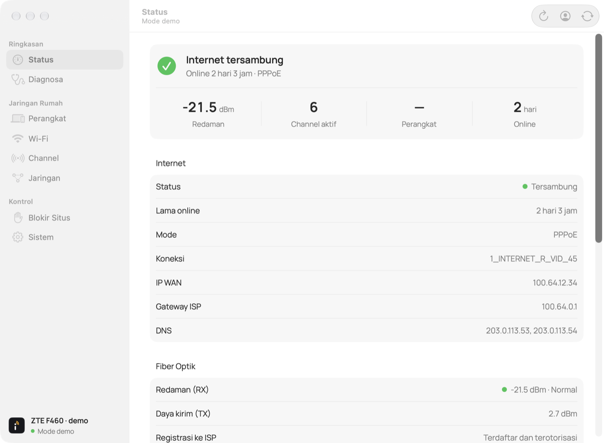
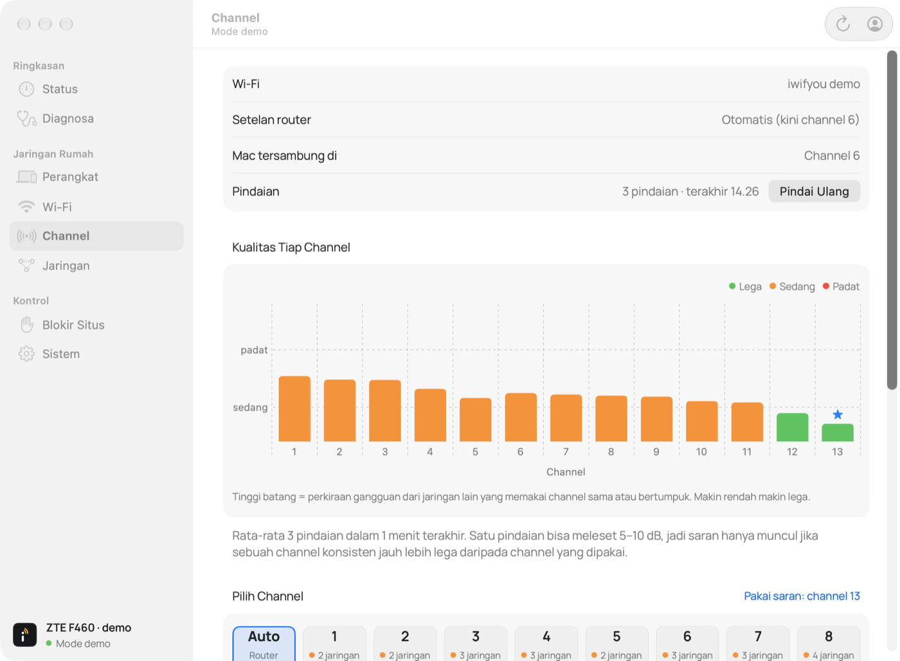
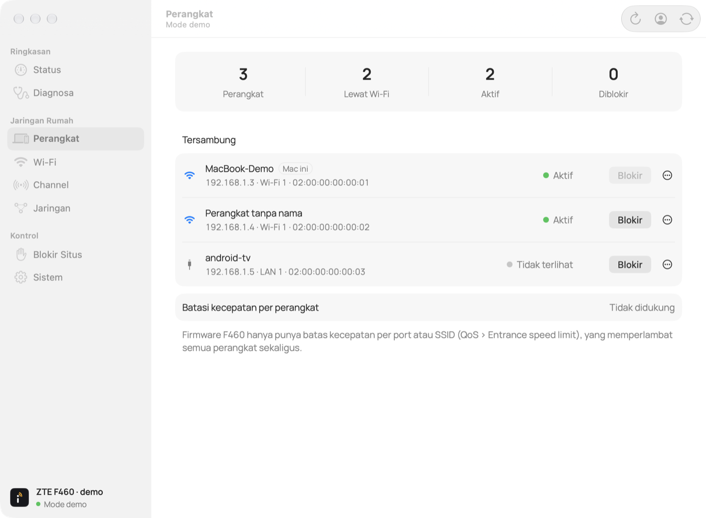
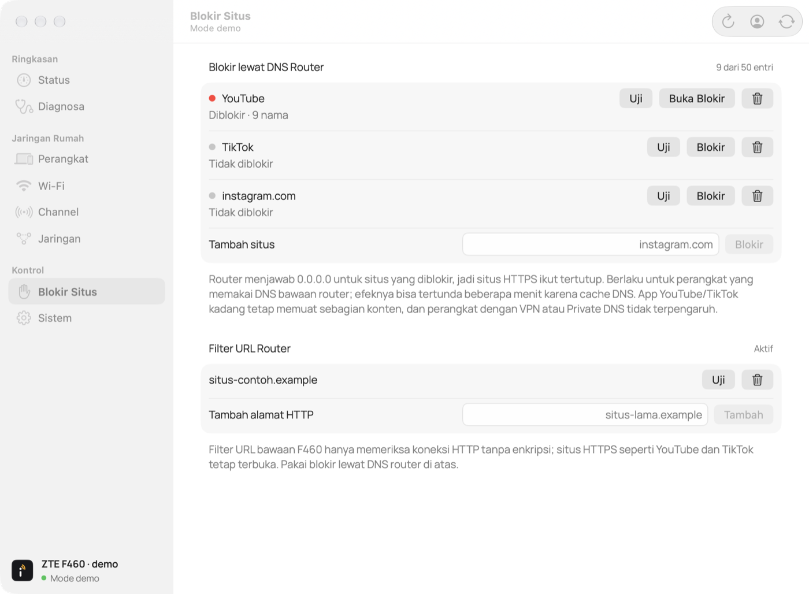

# iwifyou

A native macOS app for the **ZTE F460** fiber router, so you don't have to open the `192.168.1.1` admin panel in a browser. It runs as a normal window app with a menu bar item for quick channel changes.

[Bahasa Indonesia](README.id.md) · The app's interface is in Bahasa Indonesia.



> [!WARNING]
> iwifyou is an independent project. It is **not affiliated with or endorsed by ZTE** or any internet provider. It has been tested against **one** ISP-supplied F460 unit. Other firmware variants may differ, and the app refuses pages it does not recognise. Changing router settings can drop your connection; use it at your own risk (see [LICENSE](LICENSE)).

## Features

| Screen | What it does |
|---|---|
| **Status** | Internet connection (PPPoE, WAN IP, DNS, uptime), fiber RX/TX power rated normal/marginal/poor, ISP registration, active channel, router model and firmware |
| **Diagnosis** | One verdict (Wi-Fi, router, fiber/ISP or DNS) from the Mac's signal, pings to the router and to `1.1.1.1`, DNS and the router's WAN status, plus a **live signal meter** |
| **Devices** | DHCP clients with IP, MAC, Wi-Fi/LAN port and hostname; online state from the ARP table; **block/unblock** through the router's MAC filter; local names |
| **Wi-Fi** | SSID, security, encryption, standard, channel width, transmit power, region; **change the network name and password** |
| **Channel** | Per-channel quality chart averaged over several Wi-Fi scans from the Mac. A channel is suggested only when it is consistently and clearly less crowded than the current one. Apply a channel or Auto |
| **Network** | DHCP reservations and port forwarding, with a warning when the WAN address is behind CGNAT |
| **Site blocking** | Block sites through the **router's DNS** (Hosts entries pointing to `0.0.0.0`), which also works for HTTPS. Presets for YouTube and TikTok, custom domains, and a DNS test. The firmware's own URL filter is shown too, but it only affects plain HTTP |
| **System** | Restart with an offline → online check, slow-connection notifications with a channel suggestion, new-device notifications, admin session handling |

Per-device speed limits are **not** available: this firmware only has per-port/per-SSID QoS limits, which slow down every device at once.

<p>
  
  
</p>
<p>
  
</p>

## Install

### Download

1. Download `iwifyou-<version>-macos.zip` from the [latest release](https://github.com/ajipurn/iwifyou/releases/latest). It runs on Apple Silicon and Intel Macs with macOS 14 or later.
2. Unzip it and move `iwifyou.app` to **Applications**.
3. The app is not notarized by Apple, so the first launch is blocked:
   - **macOS 15 or later:** open the app once, then go to **System Settings › Privacy & Security** and click **Open Anyway**.
   - **macOS 14:** Control-click the app, choose **Open**, then confirm.

Or, if you prefer the terminal, remove the download flag once: `xattr -dr com.apple.quarantine /Applications/iwifyou.app`.

### Build from source

- macOS 14 or later
- Swift 6.2 or later (Xcode 26, or the Command Line Tools)
- No third-party packages

```sh
git clone https://github.com/ajipurn/iwifyou.git
cd iwifyou
./scripts/build-app.sh
open build/iwifyou.app
```

A local build opens normally. Add `--universal` to build for both Apple Silicon and Intel, as the release does.

On first launch the **Router account** window asks for the router address (usually `192.168.1.1`) and the admin login. Saving the password in the Keychain is optional. Location access is only needed to show the names of nearby networks; macOS requires it for Wi-Fi scan results.

### Try it without a router

Demo mode shows sample data and never contacts a router or the Keychain:

```sh
build/iwifyou.app/Contents/MacOS/iwifyou --demo
```

Quit any other iwifyou instance first.

## How it stays safe

- **Verified changes only.** Each change is submitted once and then the page is read again. Success is shown only after the router reports the new value; an interrupted request is never re-sent automatically.
- **Fails closed.** Pages are parsed from the router's own form fields without running its JavaScript. An unexpected page structure is reported as unsupported firmware instead of guessing a payload.
- **Minimal writes.** Payloads mirror what the router's own pages send and leave every other setting unchanged (`NULL`), e.g. a channel change writes only the channel.
- **Local only.** Only private IPv4 and loopback addresses are accepted, and redirects to other origins are refused. There is no telemetry or cloud service. Diagnosis only pings the router and `1.1.1.1` and resolves `apple.com`.
- **Secrets.** Session cookies live in memory. The password is stored only if you choose the Keychain. The Wi-Fi password is never shown.
- **One admin at a time.** The F460 allows a single admin session, so the app logs out after 2 minutes idle and never forces another admin out.

The F460 admin panel uses plain HTTP, so the login is not encrypted on your local network. Use it on a network you trust.

What has been verified on a real router and what has only run against the local simulator is listed in [README.id.md](README.id.md#integrasi-f460).

## Development

```sh
swift build
./scripts/test.sh
```

Integration tests run against a synthetic router simulator that only listens on loopback:

```sh
python3 scripts/router-simulator.py --port 18742
# in another terminal
IWIFYOU_SIMULATOR=http://127.0.0.1:18742 ./scripts/test.sh
```

Simulator login: `fixture-admin` / `fixture-password`. All fixtures in `Tests/` are synthetic.

Project layout:

- `Sources/IWiFiYouCore`: page parsers, the router client, channel survey and diagnosis logic
- `Sources/iwifyou`: the SwiftUI app
- `scripts/`: app bundling, the icon generator and the simulator

## Contributing

Bug reports and support for other F460 firmware or other ZTE models are welcome. If you share router pages to help add support, **remove passwords, Wi-Fi keys, serial numbers, LOID and MAC addresses first**. Router HTML often contains the Wi-Fi password in clear text.

Please don't test write features against a router you depend on without being ready to restore its settings.

## License

[MIT](LICENSE). The bundled [Manrope](https://github.com/googlefonts/manrope) font is licensed under the SIL Open Font License 1.1.
